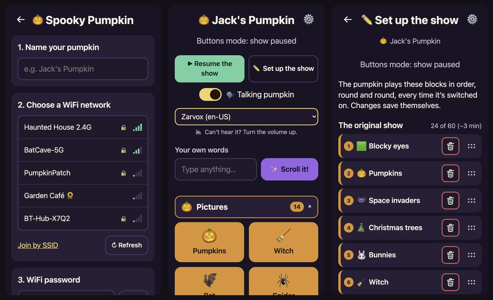
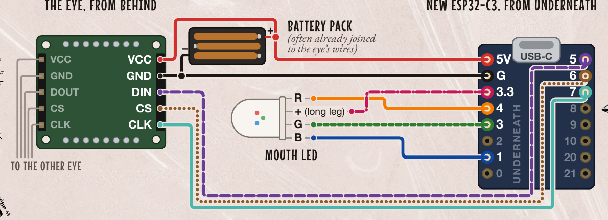

<p align="center">
  <picture>
    <source media="(prefers-color-scheme: dark)" srcset="docs/assets/title-dark.png">
    <source media="(prefers-color-scheme: light)" srcset="docs/assets/title-light.png">
    
  </picture>
</p>

<p align="center">
  
</p>

**Two glowing eyes. One pumpkin. A phone full of buttons.**

Spooky Pumpkin Eyes turns a Halloween pumpkin into a character: two 8×8 LED eyes and a colour-changing
mouth, run by a tiny ESP32-C3 board with WiFi. Switch it on and it plays its own show. Open its web page on
any phone, tablet or laptop and the show pauses for you: about 50 buttons, a talking pumpkin, and a box for
scrolling your own words across the eyes.

### Reasons to love it

- **Works straight out of the box.** Switch on and the show starts: blinks, winks, bats, ghosts, a witch on a
  broomstick, Pac-Man, a Nether portal, round and round.
- **A button for everything.** About 50 effects on one page, from eyes and pictures to creepers, endermen
  and games.
  Each press interrupts the last, so mash away.
- **A talking pumpkin.** Your phone speaks each effect's line as it plays ("Hissss!"). Pick any voice your
  phone has.
- **Your own words.** Type anything and it scrolls across the eyes.
- **Design your own show.** Add, remove and reorder blocks on the show page. It saves as you go, and that's
  what plays at switch-on.
- **No app, no cloud, no account.** Plain web pages, served by the pumpkin itself at `http://pumpkin.local`.
  Your WiFi password is stored on the board and never sent anywhere.
- **Doorstep-ready.** Carried out of WiFi range, it makes its own WiFi so trick-or-treaters' phones can
  still press the buttons.
- **Runs on 3 AA batteries.** The processor idles, the mouth LED is dimmed, and the pumpkin's own WiFi
  switches off when nobody's using it.
- **One printed page to set it up.** [The guide](docs/instructions/2026-wifi-upgrade.pdf): wiring diagram,
  WiFi setup and troubleshooting on one sheet of A4.

<p align="center">
  
</p>

## Quick start

Got a pumpkin in the post? It's already flashed and wired: skip to **Switch on**, or just follow
**👉 [the one-page guide (PDF)](docs/instructions/2026-wifi-upgrade.pdf)** that came with it.

### 1. Flash the firmware

No toolchain needed: a ready-made firmware file and a web browser.

1. Download `spooky-pumpkin-eyes-<version>-full.bin` from the
   [latest release](https://github.com/Pharkie/spooky-eyes/releases/latest).
2. Plug the ESP32-C3 SuperMini into your computer with a USB-C **data** cable.
3. In Chrome or Edge, open Espressif's [web flasher](https://espressif.github.io/esptool-js/): **Connect**
   and pick the board's port, **Erase Flash**, then add the file at address `0x0` and **Program**.
   Prefer a terminal? `pip install esptool`, then
   `esptool --chip esp32c3 write-flash -e 0x0 spooky-pumpkin-eyes-<version>-full.bin`.
   If it can't connect, hold the board's BOOT button while plugging the cable in.
4. Unplug it. Done: it's a pumpkin brain now.

### 2. Wire it

<p align="center">
  
</p>

The board is drawn from **underneath**, where its pin names are printed; the eye from **behind**.

- **Power:** battery pack **+** → `5V`, **−** → `G`. The first eye's `VCC` and `GND` join the same two.
- **The first eye** (its *input* header): `DIN` → `5`, `CS` → `6`, `CLK` → `7`.
- **The second eye:** its input header to the first eye's **output** header, pin for pin: `VCC`→`VCC`,
  `GND`→`GND`, `DOUT`→`DIN`, `CS`→`CS`, `CLK`→`CLK`. Five short wires, or the little pin headers that come
  with the modules.
- The eye wired to the board is the **right eye as you look at the pumpkin**; the chained one is the left.
- **Mouth LED:** the long leg (+) → `3.3`; red → `4`, green → `3`, blue → `1`. Mixed up the short legs? The
  mouth just shows other colours.

New to these LED modules? [GurgleApps' original tutorial](https://gurgleapps.com/learn/projects/8x8-led-matrix-halloween-jack-o-lantern-pumpkin-project-with-a-pico)
shows the matrices and the eye-to-eye chain step by step (with a Raspberry Pi Pico, so its pins differ).

### 3. Switch on

The eyes start the show, and scroll how to join the pumpkin's own WiFi: network `Spooky Pumpkin`,
password `spookyeyes`.

### 4. Connect it to your WiFi (optional)

Join that WiFi on a phone. A setup page pops up (or open `http://pumpkin.local`): name your pumpkin, pick
your WiFi, type its password, tap **Connect**. The pumpkin checks the password first, restarts, joins your
WiFi, and opens the buttons by itself. From then on, `http://pumpkin.local` on any phone, tablet or laptop
on your WiFi.

WiFi is optional: save just a name, or tap "just use the buttons", and the pumpkin keeps its own WiFi.

<details>
<summary><b>Good to know</b> (what the eyes mean, the BOOT button, batteries)</summary>

- **"Join WiFi…" again after setup?** The password was probably wrong: join the pumpkin's WiFi again and
  the setup page says what went wrong.
- **On the doorstep.** Out of reach of your WiFi for 3 minutes, the pumpkin makes its own network again, so
  you can still join it and open `http://pumpkin.local` or `http://192.168.4.1`. Back in range it rejoins
  your WiFi, unless its own WiFi has been unused for 10 minutes and switched off by then: then switch it
  off and on.
- **The BOOT button** on the board: a quick press scrolls the address again (and unlocks firmware updates
  for 5 minutes, which only work on your WiFi). Hold it for 5 seconds to forget your WiFi. That erases the
  WiFi name and password from the board's memory, so do it before passing the pumpkin on.
- **"New batteries please"** means it: weak batteries can't power the WiFi.
- **Saving batteries.** The pumpkin's own WiFi (before it's set up, or on the doorstep) switches off when
  nobody has used it for 10 minutes; the show carries on. On your WiFi it stays connected, dozing between
  messages, so the page always works. A quick BOOT press, or switching off and on, brings its own WiFi
  back. You can turn this off in Settings ("Save batteries").

</details>

## Hardware

A handful of parts:

- An **ESP32-C3 SuperMini** board
- Two **MAX7219 8×8 LED matrices**, daisy-chained ([these, Amazon UK](https://amzn.eu/d/e5Kw5vX))
- A **common-anode RGB LED** for the mouth ([these](https://amzn.eu/d/9fQ5G3V))
- A **3 × AA battery box** (about 4.5 V into the 5V pin), or a USB power bank in the USB-C socket
- Wires: the jumper leads that come with the matrices do nicely

| Wire | SuperMini pin |
|---|---|
| + power (battery pack + and eyes VCC) | 5V |
| − ground (battery pack − and eyes GND) | G |
| Eyes DIN | 5 |
| Eyes CS | 6 |
| Eyes CLK | 7 |
| Mouth LED long leg (+, common anode) | 3.3 |
| Mouth LED red | 4 |
| Mouth LED green | 3 |
| Mouth LED blue | 1 |

The pin map lives in [src/hardware/board.h](src/hardware/board.h). WiFi draws more than the old Raspberry Pi
Pico this project started on, so fresh batteries help.

## How it works

- **C++ firmware** on the ESP32-C3 (Arduino framework, built with PlatformIO). The effects are portable
  code with no Arduino headers, so they run in tests on your computer too.
- **The web pages are compiled into the firmware**, gzipped, so there's no filesystem to upload and a
  firmware update updates the pages too.
- **Its own WiFi with a captive portal** until it's set up: join "Spooky Pumpkin" and the setup page pops up.
  On your WiFi it answers at `pumpkin.local`.
- **A talking pumpkin** by server-sent events: the pumpkin tells the page what to say, and the phone says
  it with its own speech voices.
- **Updates from the Settings page** over WiFi, with a 30-second trial: firmware that crashes is rolled
  back by the bootloader.
- **Battery care:** 80 MHz CPU, a PWM-dimmed mouth LED, and the pumpkin's own WiFi off when idle.

## Building and hacking

You need [PlatformIO](https://platformio.org/) (`pip install platformio`).

```
pio run -e supermini              # build
pio run -e supermini -t upload    # flash over USB
pio device monitor                # serial log (115200)
pio test -e native                # effect tests on this computer, no board needed
python3 tools/mock_server.py      # try the web pages in a browser with a fake pumpkin
```

Over USB the board also takes simple serial commands: `list`, `play creeper`, `say Hello`, `show`,
`name Jack's Pumpkin`, `status`, `unlock` (a short BOOT press), `fs`, `help`.

**Adding an effect** is a function in `src/effects/effects.cpp` and one line in the table in
`src/effects/registry.cpp`: the button appears on the page, the surprise show can pick it, and the tests
smoke-test it. [CLAUDE.md](CLAUDE.md) explains how the pieces fit together.

<details>
<summary><b>Testing</b></summary>

```
pio test -e native                                   # the effects, frame by frame
python3 tools/api_check.py --mock                    # the web API cases on the mock, in every WiFi mode
python3 tools/api_check.py --board http://pumpkin.local             # the same cases on a real board
python3 tools/api_check.py --board http://pumpkin.local --compare   # board and mock side by side
```

The pages are mostly tried out against the mock server, so the mock must answer exactly as the firmware
does. `api_check` sends both the same 150 or so requests from [test/api/cases.py](test/api/cases.py),
nasty ones included (emoji, accents, curly quotes, NUL, `%"\`, lengths at and one past every limit), and
fails on any wrong status code or JSON shape; a different error message is a warning. On a board it notes
the settings and saved show first and puts them back afterwards, and it never restarts the board or saves
or forgets WiFi unless told to (`--allow-restart`, `--allow-wifi-save`, `--allow-forget`). For a board on
its own setup WiFi, join "Spooky Pumpkin" and use `--board http://192.168.4.1`. Don't press BOOT in the 5
minutes before a board run (`--serial` presses it over USB for the few cases that need it).

With a board on USB (these need pyserial, which PlatformIO's Python has:
`/Library/Frameworks/Python.framework/Versions/3.11/bin/python3`):

```
python3 tools/pumpkin_serial.py status               # WiFi mode, address, player, memory, uptime, version
python3 tools/pumpkin_serial.py unlock               # the same as a short BOOT press
python3 tools/pumpkin_serial.py fs                   # storage used, and whether a show is saved
python3 tools/pumpkin_serial.py monitor --reset      # the log, timestamped, from the start
python3 tools/flash_check.py release/spooky-pumpkin-eyes-<version>-full.bin
```

`flash_check` erases and flashes a board as for posting, then reads its first boot and prints PASS or FAIL
for each line it should log (version, fresh settings, storage, effects, setup WiFi, web server) and for
no crash, brownout or restart. `--log-file boot.log` checks a saved log instead.

What needs real phones and routers is in
[docs/testing/pre-posting-checklist.md](docs/testing/pre-posting-checklist.md).

</details>

<details>
<summary><b>Making a release and preparing pumpkins</b></summary>

```
python3 scripts/build_release.py
```

This writes two images to `release/` (gitignored). A build in a checkout with `local/credits.h` includes
that private credit, so keep those files private. `python3 scripts/build_release.py --public` builds
without it, into `release/public/`, checks the images are clean, and those are the ones to attach to a
GitHub release. Tag the commit you flash (e.g. `git tag 2026.10.2`), and bump `FIRMWARE_VERSION` for every
image handed out, so a pumpkin's Settings page can show that an update worked.

- `spooky-pumpkin-eyes-<version>-full.bin`: for a new board, flashed at address 0x0.
- `spooky-pumpkin-eyes-<version>-ota.bin`: to update a pumpkin that's already running, from its Settings
  page (no cable needed; it must be on the home WiFi, and you'll be asked to press the BOOT button on the
  board first).

Every board gets the same firmware and leaves identical: it's called "Spooky Pumpkin" until its new owner
names it on the setup page (or later in Settings). Nothing to track per person.

1. Erase and flash each board over USB. Erasing matters: it clears any test WiFi details and old settings.
   ```
   esptool --chip esp32c3 write-flash -e 0x0 release/spooky-pumpkin-eyes-<version>-full.bin
   ```
   (esptool v4: `esptool.py --chip esp32c3 write_flash -e 0x0 ...`; nothing installed:
   `pio pkg exec -p tool-esptoolpy -- esptool.py --chip esp32c3 write_flash -e 0x0 ...`; or Chrome and
   Espressif's [web flasher](https://espressif.github.io/esptool-js/): Erase Flash, then program at 0x0.)
   If esptool can't connect, hold BOOT while plugging in the USB cable, then press RST after flashing.
   `python3 tools/flash_check.py release/spooky-pumpkin-eyes-<version>-full.bin` does this step and checks
   the board's first boot (see Testing).
2. Switch it on with the eyes attached and check they scroll "Join WiFi: Spooky Pumpkin ...".
3. Print the guide, [docs/instructions/2026-wifi-upgrade.pdf](docs/instructions/2026-wifi-upgrade.pdf),
   once per pumpkin (`tools/make_instructions.sh` rebuilds it from the HTML next to it).

</details>

<details>
<summary><b>How the code is organised</b></summary>

| Folder | What's there |
|---|---|
| `src/effects/` | The effects, the building blocks they use, and `registry.cpp`, the one table of buttons |
| `src/display/` | Frames, fonts and all the pictures |
| `src/player/` | Show mode (plays the saved show) and buttons mode (plays presses, each interrupting the last) |
| `src/hardware/` | Pin map and drivers: MAX7219 eyes, mouth LED, status LED, BOOT button |
| `src/core/` | Settings (saved in flash), WiFi and captive portal (from Scribe Evolution), constants |
| `src/web/` | Web server and JSON API |
| `web/` | The pages: buttons, show creator, setup, settings |
| `test/` | Golden tests: the C++ effects frame-for-frame against recordings of the 2023-24 MicroPython version; `test/api/`: the web API cases |
| `docs/instructions/` | The printed one-page guide for the 2026 WiFi upgrade |
| `docs/testing/` | The checks before posting that need phones and routers |

</details>

## Like this project?

If it made a pumpkin grin, give it a ⭐ so other Halloween tinkerers can find it.

## LLM generated, human reviewed

This code was written with [Claude Code](https://claude.com/claude-code) (Anthropic), mostly on Claude Opus
5.5 and Fable 5.1, directed and reviewed throughout by the human author. The firmware was tested on real
boards and phones, with automated tests for the effects and the web API, and reviewed for security and
privacy before the pumpkins were posted. Still, it has had limited manual review: make your own checks, and
use it at your own risk.

## Credits

- Original pumpkin eyes code and tutorial by [GurgleApps](https://gurgleapps.com/learn/projects/8x8-led-matrix-halloween-jack-o-lantern-pumpkin-project-with-a-pico)
  ([gurgleapps/pico-pumpkin](https://github.com/gurgleapps/pico-pumpkin), GPL): the eye pictures, many of
  the shapes, the first eye animations and the scrolling font are theirs. This project began in 2023 as a
  fork of it, called pico-pumpkin while it ran on a Raspberry Pi Pico; it became spooky-eyes in 2026 with
  the move to the ESP32-C3 and a rewrite in C++. The 2023-24 MicroPython version isn't kept here any more: it
  lives on in the history before then, and in GurgleApps' repo.
- WiFi setup, captive portal and web server patterns from Adam's Scribe Evolution project.
- Libraries: [ArduinoJson](https://arduinojson.org/) (MIT),
  [ESPAsyncWebServer and AsyncTCP](https://github.com/esphome/ESPAsyncWebServer) (LGPL 3.0), and
  [arduino-esp32](https://github.com/espressif/arduino-esp32) (LGPL 2.1), each under its own licence.
- Eyes: MAX7219 8x8 matrices ([these, Amazon UK](https://amzn.eu/d/e5Kw5vX)); mouth: a common-anode RGB LED
  ([these](https://amzn.eu/d/9fQ5G3V)).
- The "That Blocky Game" effects are a six-year-old's fan art. Minecraft is a trademark of Mojang
  Synergies AB; this project isn't affiliated with or endorsed by Mojang or Microsoft.

## Licence

GNU General Public License, version 3 or (at your option) any later version: see [LICENSE](LICENSE). It
includes GurgleApps' GPL pictures, animations and font, released under the GPL without a version number
(which lets anyone choose any version); this project uses version 3 or later throughout.
