# The effects

Every button on the pumpkin's page, drawn from a recording of the firmware at a new pumpkin's settings
(brightness 2, eye gap 8, named "Jack's Pumpkin"). The talking pumpkin says the phrase as the effect
starts. **Surprise** picks one at random, again and again, from all of these except Surprise show and Witches' spell.

There's also a box on the page for scrolling your own words across the eyes.

Made by `python3 tools/effects_index.py` from the table in [src/effects/registry.cpp](../src/effects/registry.cpp);
run it again whenever an effect changes.

## Pictures

| | Effect | The pumpkin says |
|---|---|---|
| 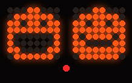 | 🎃 **Pumpkins** | "Chomp chomp chomp!" |
| 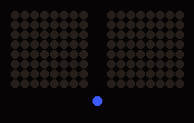 | 🧹 **Witch** | "Hee hee hee! Here I come on my broomstick!" |
| 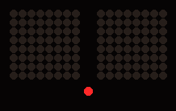 | 🦇 **Bat** | "Squeak squeak! I'm a bat!" |
|  | 🕷️ **Spider** | "Eek! A spider!" |
| 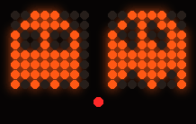 | 👻 **Ghosts** | "Woooooooo!" |
| 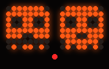 | 💀 **Skull** | "Rattle rattle rattle!" |
| 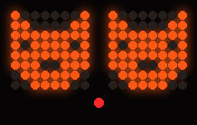 | 🐱 **Cat** | "Meow!" |
|  | 🟡 **Pac-Man** | "Waka waka waka waka!" |
| 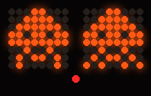 | 👾 **Space invaders** | "The space invaders are coming!" |
| 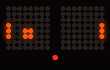 | 🏓 **Pong** | "Boing! Boing! Boing!" |
| 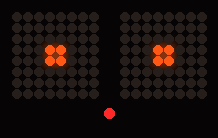 | 🌟 **Spinning star** | "Twinkle twinkle, little star!" |
| 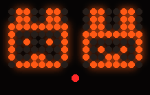 | 🐰 **Bunnies** | "Hop hop hop!" |
| 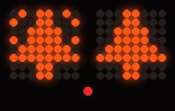 | 🎄 **Christmas trees** | "Merry Christmas!" |
| 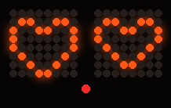 | ❤️ **Hearts** | "I love you!" |

## That Blocky Game (Eyes Edition)

| | Effect | The pumpkin says |
|---|---|---|
| 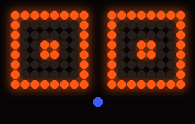 | 🟩 **Blocky eyes** | "Blocky eyes!" |
| 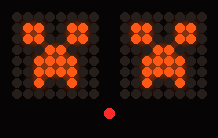 | 💥 **Creeper** |  |
| 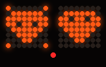 | 💎 **Diamond** | "Diamonds!" |
| 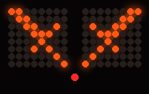 | 🗡️ **Sword** | "Swish! Swoosh!" |
| 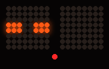 | 🟪 **Enderman** | "Don't look at the Enderman!" |
| 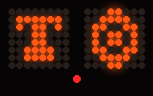 | 💚 **Emerald trade** |  |
| 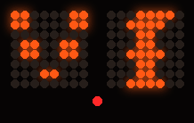 | 🐼 **Panda** | "I'm a hungry panda. Munch, munch, munch!" |
| 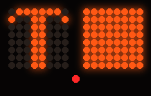 | ⛏️ **Mining** | "Let's go mining!" |
| 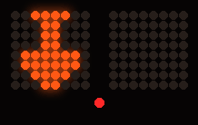 | 🪏 **Shovel** | "Dig, dig, dig!" |
| 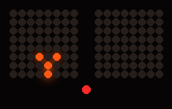 | 🪓 **Chop a tree** | "Look, a little sapling is growing!" |
| 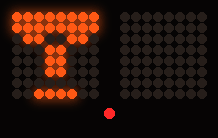 | 🌹 **Iron golem** | "Hello. I'm an iron golem." |
| 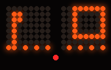 | 💡 **Redstone lamp** | "Redstone power!" |
| 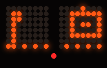 | 🧨 **Redstone TNT** | "Uh oh. Redstone, and TNT!" |
| 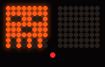 | 🔥 **Ghast** | "Watch out, a ghast!" |
| 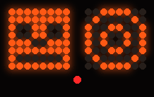 | 🏹 **Skeleton** | "A skeleton with a bow and arrow!" |
| 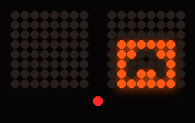 | 🟢 **Slime** |  |
| 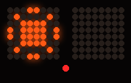 | 🌙 **Day and night** |  |
| 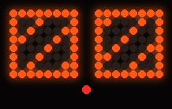 | 🌀 **Nether portal** | "The Nether portal is opening!" |

## Eyes

| | Effect | The pumpkin says |
|---|---|---|
| 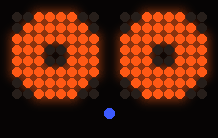 | 👀 **Stare and blink** | "Blink blink." |
|  | 😉 **Wink left** | "Wink!" |
|  | 😜 **Wink right** | "Wink wink!" |
|  | 🙄 **Roll eyes** | "Whatever!" |
|  | 👇 **Look down** | "What's down there?" |
|  | 🔍 **Grow eyes** | "Whoa!" |
| 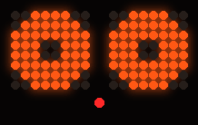 | 😠 **Angry** | "Gurrr! I'm really cross!" |
|  | 😴 **Sleepy** | "I'm so sleepy. Snore... snore..." |
|  | 🤪 **Cross-eyed** | "Ooh, I'm going cross-eyed!" |

## Games

| | Effect | The pumpkin says |
|---|---|---|
| 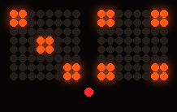 | 🎲 **Roll the dice** | "Rolling the dice!" |
| 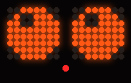 | 🎱 **Magic pumpkin** | "Hmm, let me think." |
| 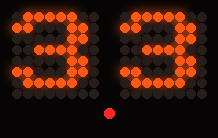 | 😱 **3, 2, 1… BOO!** |  |
| 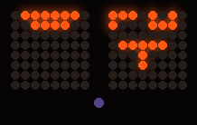 | 🎰 **Fruit machine** | "Spin to win!" |
|  | 🔀 **Surprise show** | "Surprise!" |

## Words

| | Effect | The pumpkin says |
|---|---|---|
|  | ⭐ **My name** |  |
| 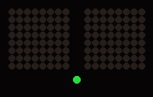 | 🧙 **Witches' spell** | "Double, double, toil and trouble. Fire burn, and cauldron bubble!" |
|  | 🍬 **Trick or Treat?** | "Trick or treat!" |
|  | 🦉 **Happy Halloween!** | "Happy Halloween!" |
